# Документация проекта Django: Система управления отелями

## Оглавление

1. [Введение](#введение)
2. [Структура проекта](#структура-проекта)
3. [Функциональные возможности](#функциональные-возможности)
4. [Модели](#модели)
5. [Формы](#формы)
6. [URL-адреса](#url-адреса)
7. [Представления](#представления)
8. [Администрирование](#администрирование)
9. [Заключение](#заключение)

## Введение

Данный проект — это система управления отелями, позволяющая пользователям бронировать номера, оставлять отзывы, а администраторам — управлять заселением и выселением через административную панель.

## Структура проекта

Основные файлы и директории проекта:

- models.py: Определение моделей базы данных для отелей, номеров, бронирований, отзывов и гостей.
- forms.py: Формы для регистрации и создания бронирований.
- views.py: Представления, реализующие основную логику работы с данными.
- urls.py: Настройка маршрутов приложения.
- admin.py: Настройки административной панели для управления данными.
- settings.py: Настройки для проекта Django.
- templates: Страницы html.


## Функциональные возможности

**Навигационная панель**

Панель, на которой расположены все необходимые страницы для управления бронированием. Также есть две страниц предназначенные только для привилегированных пользователей (Админ-панель, Постояльцы за последний месяц), остальным пользователям он не видны.


**Домашняя страница**

1. Возможность зарегистрироваться или войти в уже созданный аккаунт.
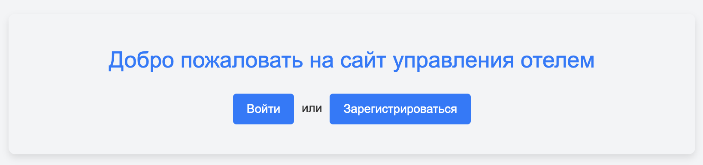

2. Возможность выйти из аккаунта
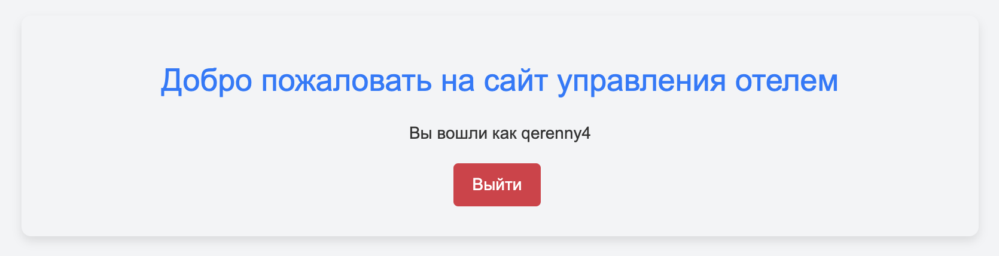

**Регистрация пользователей**

Возможность создания нового аккаунта. Все поля являются обязательными. Email был добавлен в базовую форму регистрации, как обязательный.
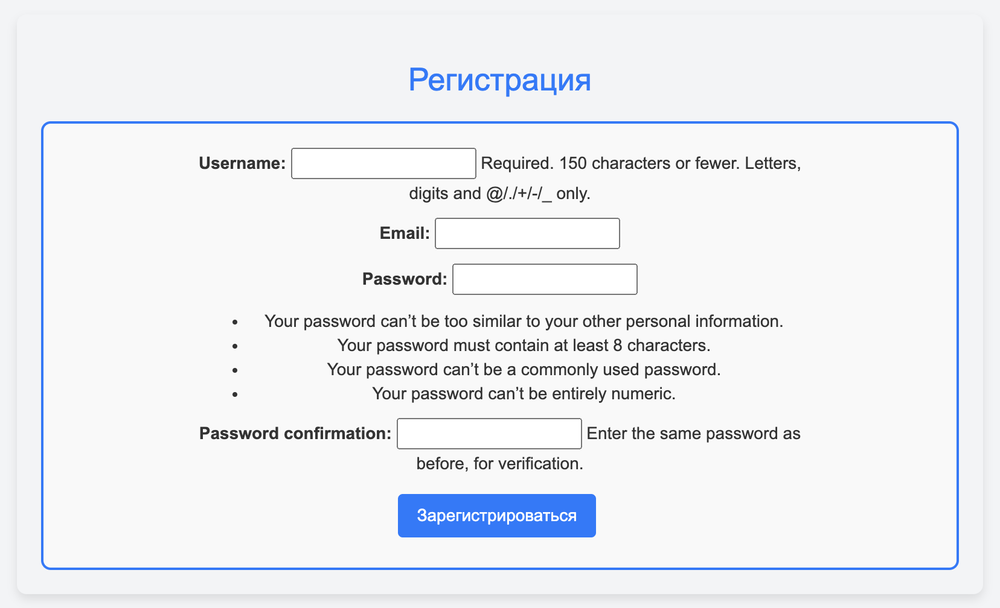

**Вход в аккаунт**

Возможность войти в аккаунт.
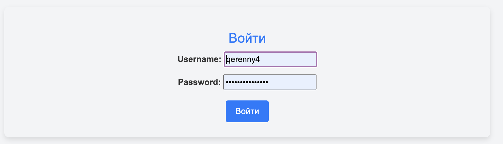

**Просмотр списка номеров**

Просмотр доступных номеров с пагинацией 2 объекта на страницу.
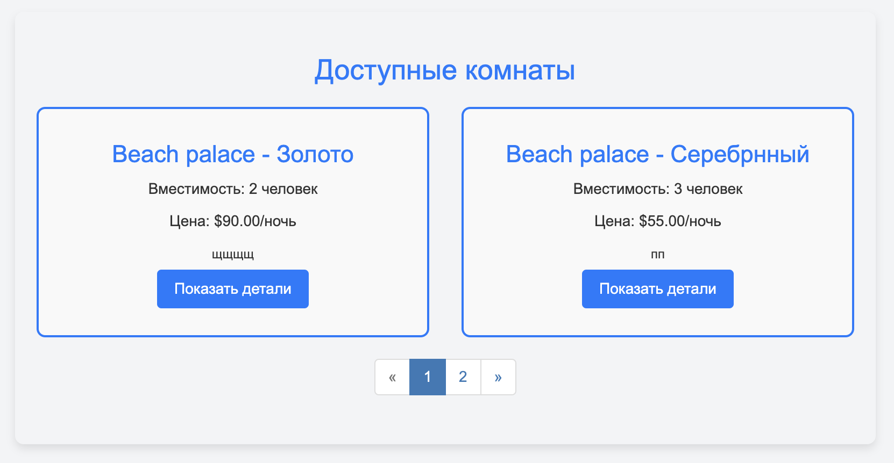

**Детали номера**
Информация о номере, а также отзывы, оставленные пользователями, которые уже бронировали данный номер. И кнопка, которая позволяет забронировать номер авторизованным пользователям.
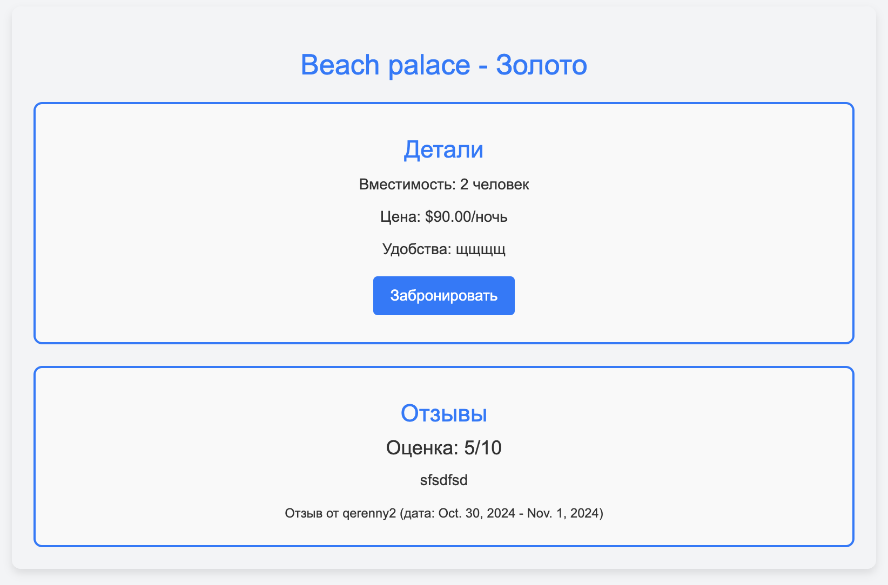

**Бронирование номера**

Форма с выбором дат. Если на данные даты уже номер занят, то высветится причина, и не даст забронировать.
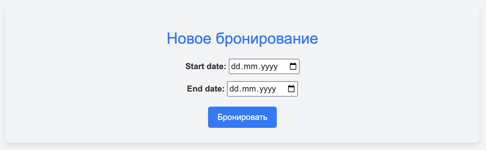

**Список с бронированиями**

Список, которые показывает забронированные пользователем номера, также есть возможность оставить отзыв (единожды), обновить даты бронирования, а также удалить бронирование. Если бронирование уже "сompleted", то пропадает возможность редактировать и удалять бронирование.
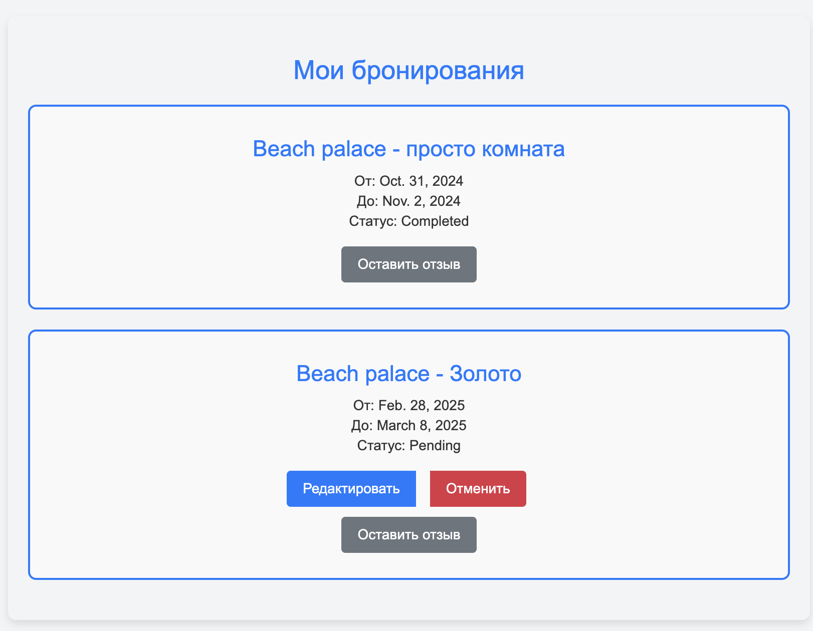

**Редактирование бронированиями**

Редактирование бронирования.
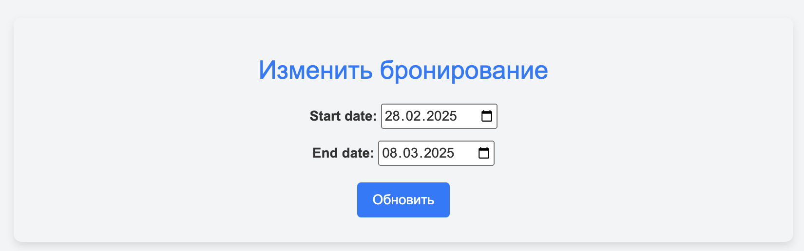

**Удаление бронированиями**

Удаление бронирования, пользователю выведется дополнительное окно с подтверждением действия.
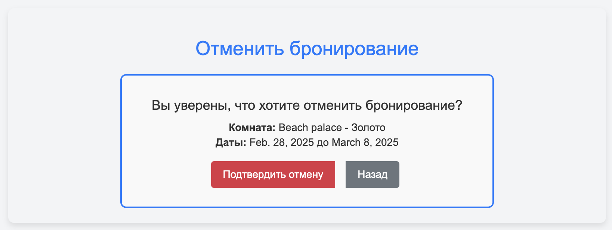

**Оставление отзывов**

Пользователи могут оставить отзыв о своих бронированиях c рейтингом от 1 до 10 и текстовым описанием.
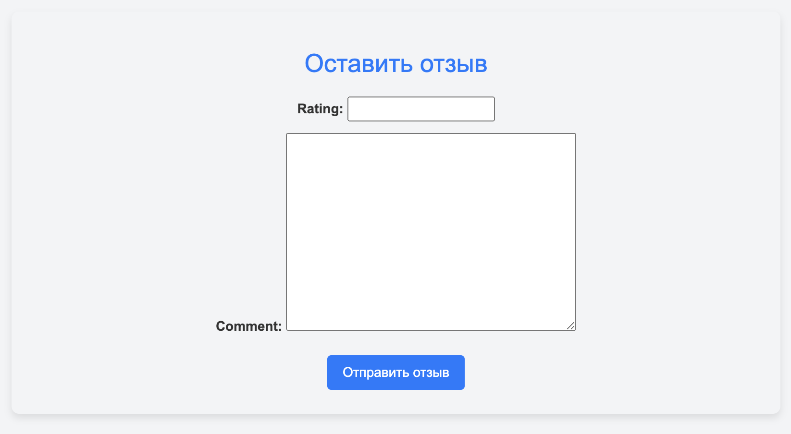

**Просмотр постояльцев за последний месяц**: 

Таблица с информацией о гостях за последние 30 дней.
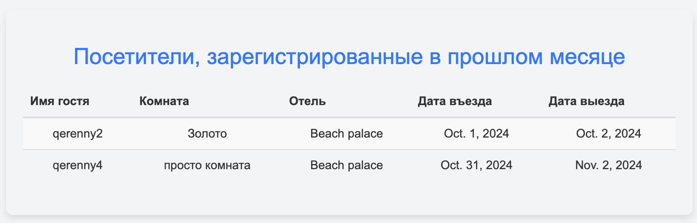


**Административное управление**

Широкие возможности управления процессами в отеле администратора.
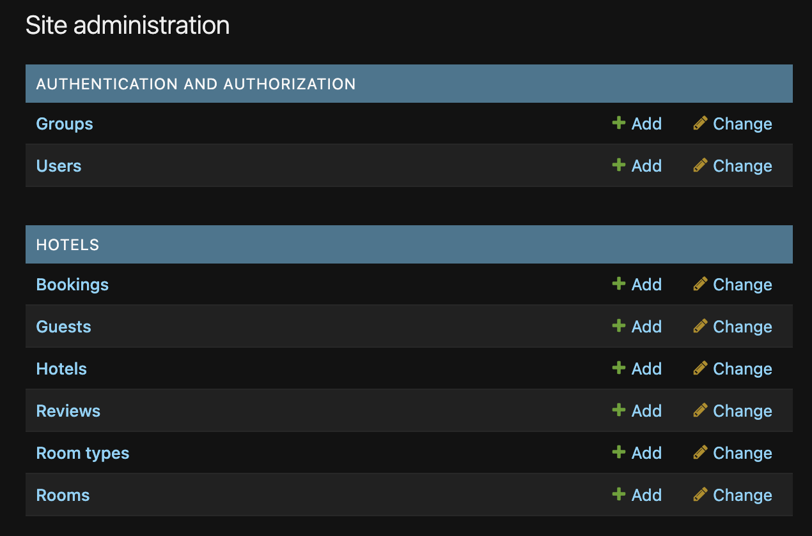

**Управление статусом бронирования в админ-панели**

Возможность выставить статус "заселяется" или "заселен" нескольким пользователям при помощи дополнительных действий.
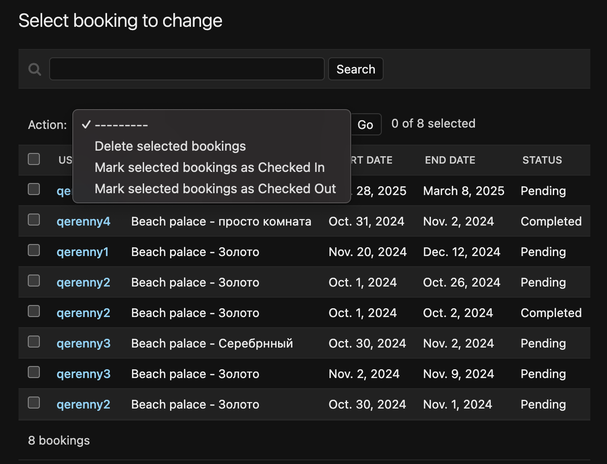

## Модели

**Функция проверки даты**

Проверяет правильно ли пользователь ввел дату, и не сделал бронирование на уже прошедшие дни
```python
# Проверка, что дата установлена на будущее
def validate_future_date(value):
    if value < date.today():
        raise ValidationError(
            _('%(value)s is in the past! Please enter a future date.'),
            params={'value': value},
        )
```

**Hotel**

Модель для хранения информации об отелях, включающая название, владельца, адрес и описание.
```python
# Модель отеля
class Hotel(models.Model):
    name = models.CharField(max_length=255)
    owner = models.ForeignKey(User, on_delete=models.CASCADE, related_name='hotels')
    address = models.CharField(max_length=255)
    description = models.TextField()

    def __str__(self):
        return self.name
```

**RoomType**

Модель для определения типов номеров с названиями и описаниями.
```python
# Модель типа номера (например, "Люкс", "Эконом")
class RoomType(models.Model):
    name = models.CharField(max_length=100)
    description = models.TextField()

    def __str__(self):
        return self.name
```

**Room**

Модель номеров отеля. Включает:

- Ссылку на отель и тип номера.
- Стоимость за ночь и вместимость.
- Описание удобств.

```python
# Модель номера
class Room(models.Model):
    # Отель, к которому принадлежит номер
    hotel = models.ForeignKey(Hotel, on_delete=models.CASCADE, related_name='rooms')
    # Тип номера
    room_type = models.ForeignKey(RoomType, on_delete=models.CASCADE)
    cost_per_night = models.DecimalField(
        max_digits=8,
        decimal_places=2,
        validators=[MinValueValidator(0.0)]
    )
    capacity = models.IntegerField(
        validators=[MinValueValidator(1)]
    )
    amenities = models.TextField()

    def __str__(self):
        return f"{self.hotel.name} - {self.room_type.name}"
```

**Booking**

Модель бронирования номера. Включает:

- Пользователя, номер, даты начала и окончания бронирования.
- Статус бронирования, с вариантами (pending, confirmed, checked_in, checked_out, cancelled, completed).

```python
# Модель бронирования
class Booking(models.Model):
    # Возможные статусы бронирования
    STATUS_CHOICES = [
        ('pending', 'Pending'),
        ('confirmed', 'Confirmed'),
        ('checked_in', 'Checked In'),
        ('checked_out', 'Checked Out'),
        ('cancelled', 'Cancelled'),
        ('completed', 'Completed'),
    ]
    # Пользователь, совершивший бронирование
    user = models.ForeignKey(User, on_delete=models.CASCADE, related_name='bookings')
    # Номер, который бронируется
    room = models.ForeignKey(Room, on_delete=models.CASCADE)
    start_date = models.DateField()
    end_date = models.DateField()
    # Статус бронирования
    status = models.CharField(
        max_length=20,
        choices=STATUS_CHOICES,
        default='pending'
    )

    # Проверка, что дата окончания после даты начала
    def clean(self):
        if self.start_date and self.end_date:
            if self.end_date < self.start_date:
                raise ValidationError(_('Конечная дата должна быть позже начальной.'))

    def save(self, *args, **kwargs):
        self.clean()
        super().save(*args, **kwargs)

    def __str__(self):
        return f"Booking by {self.user.username} in {self.room}"
```

**Review**

Модель отзывов к бронированию, включающая рейтинг (1-10), комментарий и период проживания.

```python
# Модель отзыва о бронировании
class Review(models.Model):
    # Бронирование, к которому относится отзыв
    booking = models.ForeignKey(Booking, on_delete=models.CASCADE, related_name='reviews')
    # Рейтинг отзыва
    rating = models.IntegerField(
        validators=[
            MinValueValidator(1, message="Рейтинг должен быть минимум 1"),
            MaxValueValidator(10, message="Рейтинг не должен превышать 10")
        ]
    )
    comment = models.TextField()

    # Установка дат проживания из бронирования
    def save(self, *args, **kwargs):
        if self.booking:
            self.start_date = self.booking.start_date
            self.end_date = self.booking.end_date
        super().save(*args, **kwargs)

    def __str__(self):
        return f"Отзыв {self.booking.user.username} для {self.booking.room}"

```

**Guest**

Модель для хранения данных о гостях, добавляющихся к бронированию.

```python
class Guest(models.Model):
    user = models.ForeignKey(User, on_delete=models.CASCADE, related_name='guest_bookings')
    booking = models.ForeignKey(Booking, on_delete=models.CASCADE)
    is_primary_guest = models.BooleanField(default=False)
    special_requests = models.TextField(blank=True, null=True)

    def __str__(self):
        return f"{self.user.u
```

## Формы

Файл forms.py содержит формы для регистрации пользователей и создания бронирований.

**UserRegistrationForm**: Используется для регистрации нового пользователя.
```python
# Форма регистрации нового пользователя
class UserRegistrationForm(UserCreationForm):
    email = forms.EmailField(required=True)

    class Meta:
        model = User
        # Поля, которые будут отображаться в форме регистрации
        fields = ('username', 'email', 'password1', 'password2')

    # Переопределение метода save для сохранения email
    def save(self, commit=True):
        user = super().save(commit=False)
        user.email = self.cleaned_data['email']
        if commit:
            user.save()
        return user

```

**BookingForm**: Форма создания бронирования, включает поля для выбора номера, даты начала и окончания проживания, проверки на то, что дата окончания после начала, и что бронирование создается на будущее.

```python
# Форма для создания нового бронирования
class BookingForm(forms.ModelForm):
    class Meta:
        model = Booking
        fields = ['start_date', 'end_date']
        # Устанавливаем виджеты для отображения календаря в полях выбора даты
        widgets = {
            'start_date': forms.DateInput(attrs={'type': 'date'}),
            'end_date': forms.DateInput(attrs={'type': 'date'}),
        }
    # Переопределение конструктора для дополнительного параметра room
    def __init__(self, *args, **kwargs):
        self.room = kwargs.pop('room', None)
        super().__init__(*args, **kwargs)

    # Проверка даты начала и окончания бронирования
    def clean(self):
        cleaned_data = super().clean()  # Получаем "очищенные" данные из формы, которые уже прошли базовую проверку Django.
        start_date = cleaned_data.get('start_date')  # Извлекаем поле start_date из очищенных данных.
        end_date = cleaned_data.get('end_date')  # Извлекаем поле end_date из очищенных данных.

        # Проверка на существующие бронирования для данной комнаты
        if start_date and end_date and self.room:
            # Проверяем, существуют ли пересекающиеся бронирования для выбранной комнаты
            existing_bookings = Booking.objects.filter(
                room=self.room,
                start_date__lte=end_date,
                end_date__gte=start_date
            ).exclude(pk=self.instance.pk if self.instance.pk else None)

            if existing_bookings.exists():
                raise forms.ValidationError('Комната уже забронирована на выбранные даты')

        return cleaned_data

```

**ReviewForm**

```python
# Форма для добавления отзыва на бронирование
class ReviewForm(forms.ModelForm):
    class Meta:
        model = Review
        fields = ['rating', 'comment']
```

## URL-адреса

Файл urls.py содержит маршруты.

**Основные маршруты**

- /: — главная страница приложения.
- /login/, /logout/: Вход и выход пользователя.
- /register/: Регистрация нового пользователя.
- /rooms/: Просмотр списка доступных номеров с деталями.
- /room/\<int:pk>/: Просмотр информации о конкретном номере.
- /room/\<int:room_pk>/book/: Создание бронирования для номера.
- /bookings/: Просмотр списка бронирований пользователя.
- /booking/\<int:pk>/edit/, /booking/\<int:pk>/delete/: Редактирование и удаление бронирования.
- /booking/\<int:booking_id>/add_review/: Добавление отзыва к бронированию.
- /recent_guests/: Таблица с постояльцами отеля за последний месяц.

```python
urlpatterns = [
    # Главная страница
    path('', views.home, name='home'),
    # Вход пользователя
    path('login/', LoginView.as_view(template_name='login.html'), name='login'),
    # Выход пользователя
    path('logout/', LogoutView.as_view(), name='logout'),
    # Регистрация нового пользователя
    path('register/', views.register, name='register'),
    # Просмотр списка комнат
    path('rooms/', views.room_list, name='room_list'),
    # Просмотр деталей комнаты
    path('room/<int:pk>/', views.room_detail, name='room_detail'),
    # Создание бронирования комнаты
    path('room/<int:room_pk>/book/', views.booking_create, name='booking_create'),
    # Список бронирований пользователя
    path('bookings/', views.booking_list, name='booking_list'),
    # Редактирование бронирования
    path('booking/<int:pk>/edit/', views.booking_update, name='booking_update'),
    # Удаление бронирования
    path('booking/<int:pk>/delete/', views.booking_delete, name='booking_delete'),
    # Добавление отзыва к бронированию
    path('booking/<int:booking_id>/add_review/', views.add_review, name='add_review'),
    # Просмотр гостей за последний месяц
    path('recent_guests/', views.recent_guests, name='recent_guests'),
]
```

## Представления

Файл views.py — представления для обработки запросов.

**Главная страница**

На главной странице отображается форма для входа и регистрации, если пользователь уже зарегистрирован, то кнопка выход.

```python
# Главная страница
def home(request):
    return render(request, 'home.html')
```

**Регистрация пользователя** 
Используется стандартная форма регистрации, используемая в Django.

```python
# Регистрация нового пользователя
def register(request):
    if request.method == 'POST':
        form = UserRegistrationForm(request.POST)
        if form.is_valid():
            user = form.save()
            login(request, user)
            messages.success(request, 'Вы успешно зарегистрировались!')
            return redirect('room_list')
    else:
        form = UserRegistrationForm()
    return render(request, 'register.html', {'form': form})
```

**Список комнат**

Отображения списком существующих комнат с описанием, также реализована пагинация для более удобного отображения номеров.

```python
# Просмотр списка доступных номеров
def room_list(request):
    search_query = request.GET.get('search', '')  # Получаем поисковый запрос, если он есть

    if search_query: # Если запрос есть, фильтруем номера по отелю или типу комнаты
        rooms = Room.objects.filter(
            hotel__name__icontains=search_query
        ) | Room.objects.filter(
            room_type__name__icontains=search_query
        )
    else: # Если нет запроса, выбираем все номера
        rooms = Room.objects.all()

    paginator = Paginator(rooms, 2)  # Количество объектов на страницу
    page_number = request.GET.get('page') # Получаем номер страницы из GET-запроса
    page_obj = paginator.get_page(page_number) # Получаем текущую страницу с объектами

    return render(request, 'room_list.html', {'page_obj': page_obj, 'search_query': search_query})
```

**Детали о номере**

Более подробная информация о комнате

```python
# Подробная информация о конкретном номере
def room_detail(request, pk):
    room = get_object_or_404(Room, pk=pk)
    reviews = Review.objects.filter(booking__room=room) # Отзывы, связанные с этим номером
    return render(request, 'room_detail.html', {'room': room, 'reviews': reviews})
```

**Бронирование комнаты**

Бронирование конкретного номера для конкретного пользователя

```python
# Создание бронирования для конкретного номера
@login_required
def booking_create(request, room_pk):
    room = get_object_or_404(Room, pk=room_pk)
    if request.method == 'POST':
        form = BookingForm(request.POST, room=room)
        if form.is_valid():
            booking = form.save(commit=False)
            booking.user = request.user
            booking.room = room
            booking.status = 'pending'
            booking.save()
            messages.success(request, 'Бронирование создано успешно!')
            return redirect('booking_list')
    else:
        form = BookingForm()
    return render(request, 'booking_form.html', {'form': form, 'room': room})
```

**Список бронирований пользователя**

Отображение списком всех бронирований пользователя

```python
# Список бронирований текущего пользователя
@login_required
def booking_list(request):
    bookings = Booking.objects.filter(user=request.user)
    return render(request, 'booking_list.html', {'bookings': bookings})
```

**Обновление бронирования**

У пользователя есть возможность обновить даты бронирования номера

```python
# Обновление информации о бронировании
@login_required
def booking_update(request, pk):
    booking = get_object_or_404(Booking, pk=pk)
    # Проверка, что пользователь является владельцем бронирования
    if booking.user != request.user:
        messages.error(request, 'Вы не можете редактировать это бронирование.')
        return redirect('booking_list')

    # Проверка, что бронь уже кончилась
    if booking.status == 'completed':
        messages.error(request, 'Вы уже не можете обновить это бронирование.')
        return redirect('booking_list')

    if request.method == 'POST':
        form = BookingForm(request.POST, instance=booking)
        if form.is_valid():
            form.save()
            messages.success(request, 'Бронирование обновлено успешно!')
            return redirect('booking_list')
    else:
        form = BookingForm(instance=booking)
    return render(request, 'booking_form.html', {'form': form, 'booking': booking})
```

**Удаление бронирования**

У пользователя есть возможность отменить бронирование

```python
# Удаление бронирования
@login_required
def booking_delete(request, pk):
    booking = get_object_or_404(Booking, pk=pk)
    if booking.user != request.user:
        messages.error(request, 'Вы не можете удалить это бронирование.')
        return redirect('booking_list')

    if booking.status == 'completed':
        messages.error(request, 'Вы уже не можете удалить это бронирование.')
        return redirect('booking_list')

    if request.method == 'POST':
        booking.delete()
        messages.success(request, 'Бронирование удалено успешно!')
        return redirect('booking_list')
    return render(request, 'booking_confirm_delete.html', {'booking': booking})
```

**Добавление отзыва к бронированию**

У пользователя есть возможность добавить отзыв к бронированию

```python
# Добавление отзыва к бронированию
def add_review(request, booking_id):
    booking = get_object_or_404(Booking, id=booking_id, user=request.user)

    # Проверка, существует ли уже отзыв для этого бронирования
    if Review.objects.filter(booking=booking).exists():
        messages.error(request, 'Вы уже создали отзыв.')
        return redirect('booking_list')

    if request.method == 'POST':
        form = ReviewForm(request.POST)
        if form.is_valid():
            review = form.save(commit=False)
            review.booking = booking # Привязываем отзыв к бронированию
            review.save()
            messages.success(request, 'Отзыв оставлен успешно!')
            return redirect('booking_list')
    else:
        form = ReviewForm()
    return render(request, 'add_review.html', {'form': form, 'booking': booking})
```

**Гости отелей за предыдущий месяц**

У админа есть возможность посмотреть старые бронирования

```python
# Просмотр последних гостей за месяц (доступен только суперпользователю)
@user_passes_test(lambda user: user.is_superuser)
def recent_guests(request):
    last_month = timezone.now().date() - timedelta(days=30) # Вычисление даты месяц назад
    guests = Booking.objects.filter(
        status='completed',
        start_date__gte=last_month
    ).select_related('user', 'room', 'room__hotel') # Выборка завершенных бронирований за последний месяц
    return render(request, 'recent_guests.html', {'guests': guests})
```


## Администрирование

**Основные возможности административной панели:**

- Управление отелями, комнатами и типами комнат.
- Управление бронированиями (заселение, выселение, изменение статусов).
- Просмотр и редактирование отзывов.
- Управление пользователями и гостями, прикрепленными к бронированиям.

```python
# Админ-панель отеля
@admin.register(Hotel)
class HotelAdmin(admin.ModelAdmin):
    list_display = ('name', 'owner', 'address')
    search_fields = ('name', 'address')
    list_filter = ('owner',)

# Админ-панель типа комнаты
@admin.register(RoomType)
class RoomTypeAdmin(admin.ModelAdmin):
    list_display = ('name',)
    search_fields = ('name',)

# Админ-панель номера отеля
@admin.register(Room)
class RoomAdmin(admin.ModelAdmin):
    list_display = ('hotel', 'room_type', 'cost_per_night', 'capacity')
    list_filter = ('hotel', 'room_type', 'capacity')
    search_fields = ('hotel__name', 'room_type__name')

# Админ-панель бронирования
@admin.register(Booking)
class BookingAdmin(admin.ModelAdmin):
    list_display = ('user', 'room', 'start_date', 'end_date', 'status')
    list_filter = ('status', 'start_date', 'end_date')
    search_fields = ('user__username', 'room__hotel__name')

    actions = ['mark_as_checked_in', 'mark_as_checked_out']

    def mark_as_checked_in(self, request, queryset):
        updated = queryset.update(status='checked_in')
        self.message_user(request, f"{updated} booking(s) marked as Checked In.")

    def mark_as_checked_out(self, request, queryset):
        updated = queryset.update(status='checked_out')
        self.message_user(request, f"{updated} booking(s) marked as Checked Out.")

    mark_as_checked_in.short_description = 'Mark selected bookings as Checked In'
    mark_as_checked_out.short_description = 'Mark selected bookings as Checked Out'

# Админ-панель отзывов
@admin.register(Review)
class ReviewAdmin(admin.ModelAdmin):
    list_display = ('booking', 'rating', 'get_start_date', 'get_end_date')
    list_filter = ('rating',)
    search_fields = ('booking__user__username', 'comment')

    def get_start_date(self, obj):
        return obj.booking.start_date
    get_start_date.short_description = 'Start Date'

    def get_end_date(self, obj):
        return obj.booking.end_date
    get_end_date.short_description = 'End Date'

# Админ-панель гостей
@admin.register(Guest)
class GuestAdmin(admin.ModelAdmin):
    list_display = ('user', 'booking', 'is_primary_guest')
    list_filter = ('is_primary_guest',)
    search_fields = ('user__username',)
```

## Заключение

Проект предоставляет широкие возможности для управления отелями, бронирования и отзывов.

