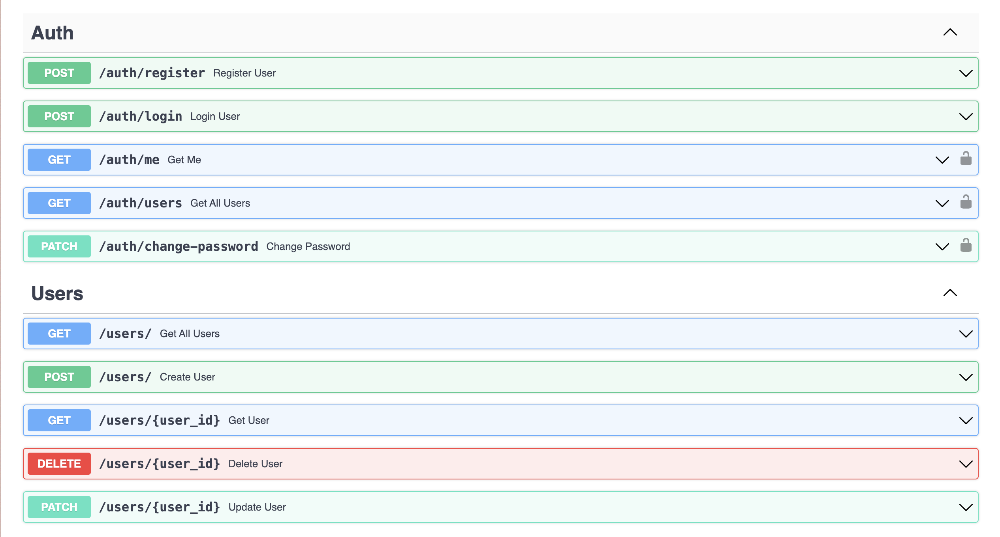
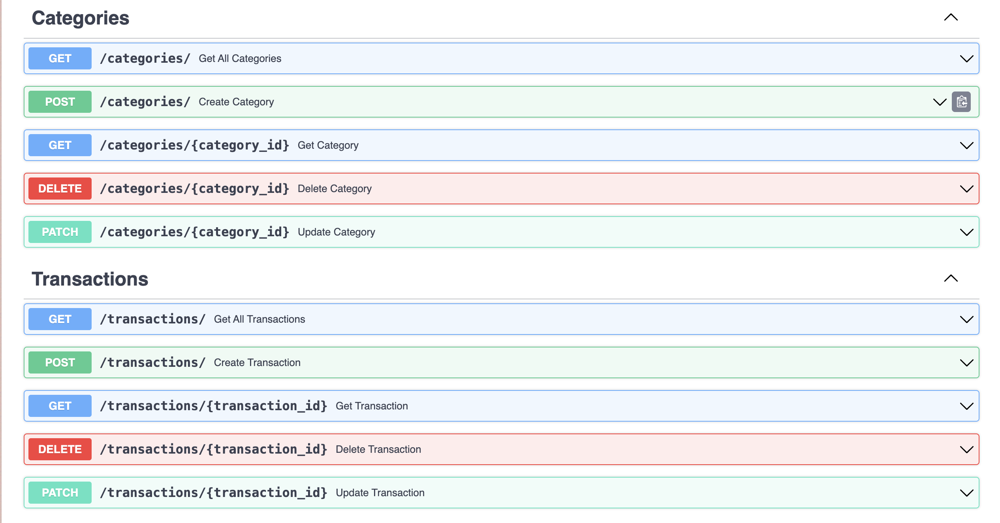
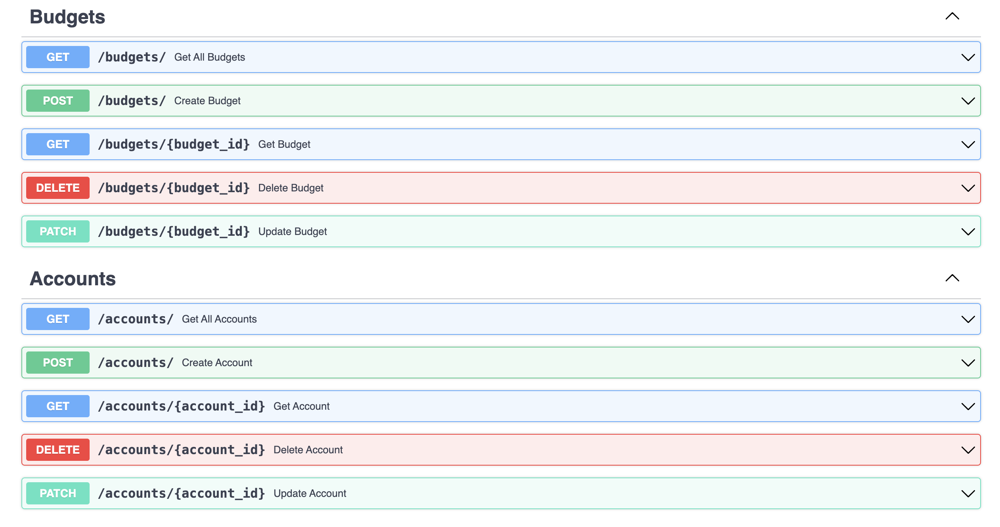
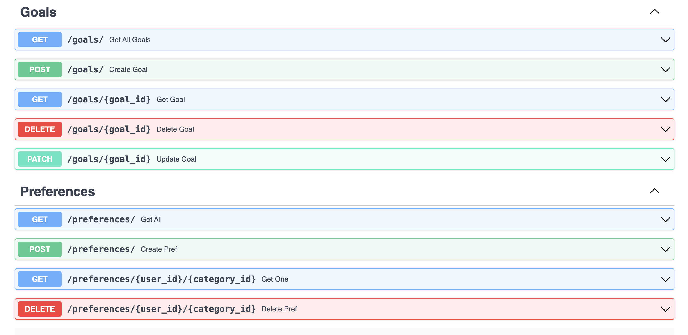

# Лабораторная работа 1: Сервис управления личными финансами

## Цель

Создать веб-приложение, позволяющее пользователям:
- Управлять доходами и расходами
- Устанавливать бюджеты на категории
- Просматривать финансовые отчёты
- Устанавливать финансовые цели
- Получать уведомления при превышении бюджета

---

## Основной функционал

- ✅ Регистрация, авторизация, JWT, смена пароля
- ✅ Управление пользователями
- ✅ CRUD для транзакций, аккаунтов, целей, категорий, бюджетов
- ✅ Вложенные связи one-to-many, many-to-many
- ✅ Автоматическая корректировка баланса счёта при транзакции
- ✅ Миграции Alembic
- ✅ Разделение на модули и схемы Pydantic

---

## Структура проекта

```text
app/
├── core/                  # Аутентификация
├── db/                   # Подключение к БД
├── models/               # SQLModel модели
├── routers/              # FastAPI роутеры
├── schemas/              # Pydantic-схемы
main.py                   # Точка входа
```

---

## Аутентификация

- `/auth/register` — регистрация
- `/auth/login` — вход
- `/auth/me` — информация о себе
- `/auth/change-password` — смена пароля
- Используется HTTPBearer

---

## Пользователи

- `GET /users/` — список
- `GET /users/{id}` — пользователь с вложенными отношениями
- `PATCH /users/{id}` — обновление
- `DELETE /users/{id}` — удаление

---

## Транзакции

- `POST /transactions/` — создание
- `GET /transactions/` — список
- `GET /transactions/{id}` — с вложенными user, category, account
- `PATCH /transactions/{id}` — пересчёт балансов
- `DELETE /transactions/{id}` — возврат суммы из счёта

---

## Счета

- `POST /accounts/`
- `GET /accounts/`
- `GET /accounts/{id}` — с вложенными транзакциями
- `PATCH /accounts/{id}`
- `DELETE /accounts/{id}`

---

## Категории

- `POST /categories/`
- `GET /categories/`
- `GET /categories/{id}` — с предпочтениями пользователей
- `PATCH /categories/{id}`
- `DELETE /categories/{id}`

---

## Бюджеты

- `POST /budgets/`
- `GET /budgets/`
- `GET /budgets/{id}` — с вложенными user и category
- `PATCH /budgets/{id}`
- `DELETE /budgets/{id}`

---

## Цели

- `POST /goals/`
- `GET /goals/`
- `GET /goals/{id}` — с вложенным user
- `PATCH /goals/{id}`
- `DELETE /goals/{id}`

---

## Предпочтения категорий (many-to-many)

- `POST /preferences/`
- `GET /preferences/`
- `GET /preferences/{user_id}/{category_id}`
- `DELETE /preferences/{user_id}/{category_id}`

---

## Модели данных

- `User` ←→ `Transaction`, `Account`, `Goal`, `Budget`, `UserCategoryPreference`
- `Transaction` — содержит связи с `Category`, `Account`
- `Budget` — связывает `User` и `Category`
- `UserCategoryPreference` — many-to-many с полем `notification_enabled`

---

## Swagger






---

## Миграции

Миграции управляются через Alembic, примеры:
```bash
alembic revision --autogenerate -m "Initial"
alembic upgrade head
```

---

### `/core/auth.py`

```python
import os
import jwt
from passlib.hash import bcrypt
from fastapi import HTTPException, status, Depends, Security
from fastapi.security import HTTPBearer, HTTPAuthorizationCredentials
from sqlmodel import Session
from datetime import datetime, timedelta

from app.db.connection import get_session
from app.models.finance_models import User

JWT_SECRET = os.getenv("JWT_SECRET", "SUPERSECRET")
JWT_ALGORITHM = "HS256"
ACCESS_TOKEN_EXPIRE_MINUTES = 60

# Определяем схему безопасности
bearer_scheme = HTTPBearer()


# хэширование
def hash_password(password: str) -> str:
    return bcrypt.using(rounds=12).hash(password)

def verify_password(plain_password: str, hashed_password: str) -> bool:
    return bcrypt.verify(plain_password, hashed_password)

# JWT
def create_access_token(user_id: int) -> str:
    expire = datetime.utcnow() + timedelta(minutes=ACCESS_TOKEN_EXPIRE_MINUTES)
    payload = {
        "sub": str(user_id),
        "exp": expire
    }
    token = jwt.encode(payload, JWT_SECRET, algorithm=JWT_ALGORITHM)
    return token

def decode_access_token(token: str) -> int:
    try:
        payload = jwt.decode(token, JWT_SECRET, algorithms=[JWT_ALGORITHM])
        user_id = int(payload["sub"])
        return user_id
    except jwt.ExpiredSignatureError:
        raise HTTPException(
            status_code=status.HTTP_401_UNAUTHORIZED,
            detail="Token expired"
        )
    except jwt.InvalidTokenError:
        raise HTTPException(
            status_code=status.HTTP_401_UNAUTHORIZED,
            detail="Invalid token"
        )

def get_current_user(
    credentials: HTTPAuthorizationCredentials = Security(bearer_scheme),
    session: Session = Depends(get_session)
) -> User:
    """
    Функция вызывается при каждом запросе к защищённому эндпоинту.
    1) HTTPBearer сам найдёт заголовок "Authorization: Bearer <token>"
    2) credentials.credentials = "<token>"
    3) Декодируем токен и получаем user_id
    4) Ищем пользователя в БД
    """
    token = credentials.credentials
    user_id = decode_access_token(token)

    user = session.get(User, user_id)
    if not user:
        raise HTTPException(
            status_code=status.HTTP_401_UNAUTHORIZED,
            detail="User not found"
        )
    return user
```


### `/models/finance_models.py`


```python
from typing import Optional, List
from sqlmodel import SQLModel, Field, Relationship
from datetime import datetime

class User(SQLModel, table=True):
    id: Optional[int] = Field(default=None, primary_key=True)
    username: str
    email: str
    hashed_password: str  

    transactions: List["Transaction"] = Relationship(back_populates="user")
    budgets: List["Budget"] = Relationship(back_populates="user")
    accounts: List["Account"] = Relationship(back_populates="user")
    goals: List["Goal"] = Relationship(back_populates="user")
    category_preferences: List["UserCategoryPreference"] = Relationship(back_populates="user")


class Category(SQLModel, table=True):
    id: Optional[int] = Field(default=None, primary_key=True)
    name: str
    transactions: List["Transaction"] = Relationship(back_populates="category")
    budgets: List["Budget"] = Relationship(back_populates="category")
    user_preferences: List["UserCategoryPreference"] = Relationship(back_populates="category")


class Transaction(SQLModel, table=True):
    id: Optional[int] = Field(default=None, primary_key=True)
    user_id: int = Field(foreign_key="user.id")
    category_id: int = Field(foreign_key="category.id")
    account_id: Optional[int] = Field(default=None, foreign_key="account.id")

    amount: float
    description: Optional[str] = None
    created_at: datetime = Field(default_factory=datetime.utcnow)

    user: Optional[User] = Relationship(back_populates="transactions")
    category: Optional[Category] = Relationship(back_populates="transactions")
    account: Optional["Account"] = Relationship(back_populates="transactions")


class Budget(SQLModel, table=True):
    id: Optional[int] = Field(default=None, primary_key=True)
    user_id: int = Field(foreign_key="user.id")
    category_id: int = Field(foreign_key="category.id")
    limit_amount: float

    user: Optional[User] = Relationship(back_populates="budgets")
    category: Optional[Category] = Relationship(back_populates="budgets")


class Account(SQLModel, table=True):
    id: Optional[int] = Field(default=None, primary_key=True)
    user_id: int = Field(foreign_key="user.id")
    name: str
    balance: float = 0.0

    user: Optional[User] = Relationship(back_populates="accounts")
    transactions: List[Transaction] = Relationship(back_populates="account")


class Goal(SQLModel, table=True):
    id: Optional[int] = Field(default=None, primary_key=True)
    user_id: int = Field(foreign_key="user.id")
    title: str
    target_amount: float
    deadline: Optional[datetime] = None
    current_amount: float = 0.0

    user: Optional[User] = Relationship(back_populates="goals")
    
class UserCategoryPreference(SQLModel, table=True):
    user_id: int = Field(foreign_key="user.id", primary_key=True)
    category_id: int = Field(foreign_key="category.id", primary_key=True)
    notification_enabled: bool = Field(default=True)

    user: Optional[User] = Relationship(back_populates="category_preferences")
    category: Optional[Category] = Relationship(back_populates="user_preferences")
```


### `/schemas/finance_schemas.py`

```python
from typing import Optional, List
from datetime import datetime
from pydantic import BaseModel

class UserRegister(BaseModel):
    username: str
    email: str
    password: str 

class UserLogin(BaseModel):
    username_or_email: str
    password: str

class UserOut(BaseModel):
    id: int
    username: str
    email: str

    class Config:
        from_attributes = True


class CreateCategory(BaseModel):
    name: str

class CreateTransaction(BaseModel):
    user_id: int
    category_id: int
    account_id: Optional[int] = None
    amount: float
    description: Optional[str] = None

class CreateBudget(BaseModel):
    user_id: int
    category_id: int
    limit_amount: float

class CreateAccount(BaseModel):
    user_id: int
    name: str
    balance: float = 0.0

class CreateGoal(BaseModel):
    user_id: int
    title: str
    target_amount: float
    deadline: Optional[datetime] = None
    current_amount: float = 0.0


# Для чтения:
class ReadCategory(BaseModel):
    id: int
    name: str
    class Config:
        from_attributes = True

class ReadTransaction(BaseModel):
    id: int
    amount: float
    description: Optional[str]
    created_at: datetime
    account_id: Optional[int] = None
    class Config:
        from_attributes = True

class ReadBudget(BaseModel):
    id: int
    limit_amount: float
    class Config:
        from_attributes = True

class ReadAccount(BaseModel):
    id: int
    name: str
    balance: float
    class Config:
        from_attributes = True

class ReadGoal(BaseModel):
    id: int
    title: str
    target_amount: float
    current_amount: float
    deadline: Optional[datetime]
    class Config:
        from_attributes = True
        
        
class CreateUserCategoryPreference(BaseModel):
    user_id: int
    category_id: int
    notification_enabled: bool = True

class ReadUserCategoryPreference(BaseModel):
    user_id: int
    category_id: int
    notification_enabled: bool
    class Config:
        from_attributes = True

# ----------------------------------------------------------------
# ----------------------------------------------------------------
# ----------------------------------------------------------------

class ReadUserWithRelations(UserOut):
    accounts: List[ReadAccount] = []
    transactions: List[ReadTransaction] = []
    budgets: List[ReadBudget] = []
    goals: List[ReadGoal] = []
    category_preferences: List[ReadUserCategoryPreference] = []

    class Config:
        from_attributes = True


class ReadAccountWithTransactions(ReadAccount):
    transactions: List[ReadTransaction] = []

    class Config:
        from_attributes = True

class ReadCategoryWithUsers(ReadCategory):
    user_preferences: List[ReadUserCategoryPreference] = []

    class Config:
        from_attributes = True


class ReadGoalWithUser(ReadGoal):
    user: Optional[UserOut] = None

    class Config:
        from_attributes = True


class ReadBudgetFull(ReadBudget):
    user: Optional[UserOut] = None
    category: Optional[ReadCategory] = None

    class Config:
        from_attributes = True


class ReadTransactionFull(ReadTransaction):
    user: Optional[UserOut] = None
    category: Optional[ReadCategory] = None
    account: Optional[ReadAccount] = None

    class Config:
        from_attributes = True
```


### `/routers/users.py`

```python
from fastapi import APIRouter, Depends, HTTPException
from sqlmodel import select
from typing import List
from sqlmodel import Session
from sqlalchemy.orm import selectinload

from app.db.connection import get_session
from app.models.finance_models import User
from app.schemas.finance_schemas import UserRegister, UserOut, ReadUserWithRelations

router = APIRouter(prefix="/users", tags=["Users"])

@router.post("/", response_model=UserOut)
def create_user(user: UserRegister, session: Session = Depends(get_session)):
    new_user = User(
        username=user.username,
        email=user.email
    )
    session.add(new_user)
    session.commit()
    session.refresh(new_user)
    return new_user

@router.get("/", response_model=List[UserOut])
def get_all_users(session: Session = Depends(get_session)):
    result = session.exec(select(User)).all()
    return result

@router.get("/{user_id}", response_model=ReadUserWithRelations)
def get_user(user_id: int, session: Session = Depends(get_session)):
    stmt = (
        select(User)
        .where(User.id == user_id)
        .options(
            selectinload(User.accounts),
            selectinload(User.transactions),
            selectinload(User.budgets),
            selectinload(User.goals),
            selectinload(User.category_preferences)
        )
    )
    user = session.exec(stmt).first()
    if not user:
        raise HTTPException(status_code=404, detail="User not found")
    return user

@router.patch("/{user_id}", response_model=UserOut)
def update_user(user_id: int, user_data: UserRegister, session: Session = Depends(get_session)):
    db_user = session.get(User, user_id)
    if not db_user:
        raise HTTPException(status_code=404, detail="User not found")
    db_user.username = user_data.username
    db_user.email = user_data.email

    session.add(db_user)
    session.commit()
    session.refresh(db_user)
    return db_user

@router.delete("/{user_id}")
def delete_user(user_id: int, session: Session = Depends(get_session)):
    db_user = session.get(User, user_id)
    if not db_user:
        raise HTTPException(status_code=404, detail="User not found")
    session.delete(db_user)
    session.commit()
    return {"ok": True}
```