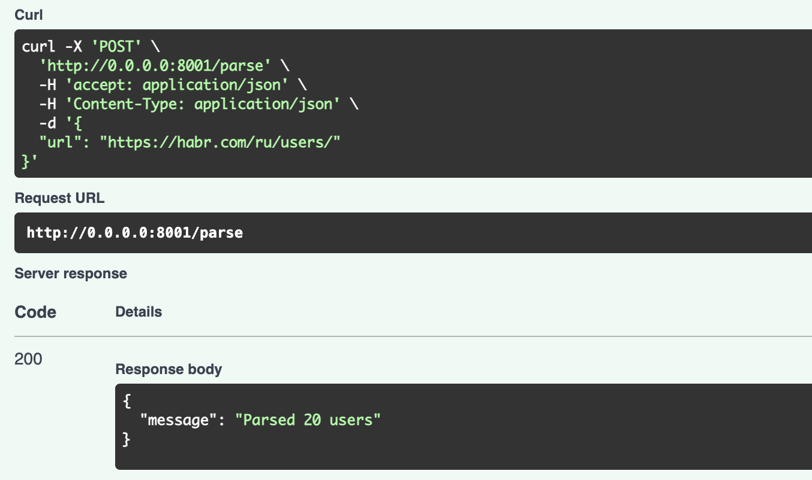
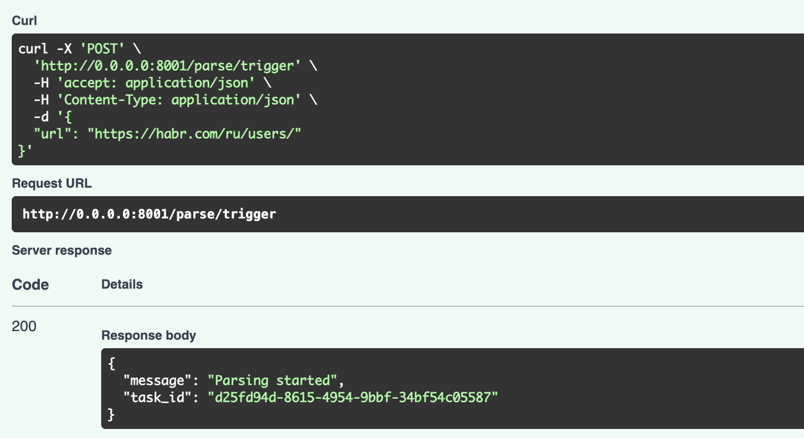
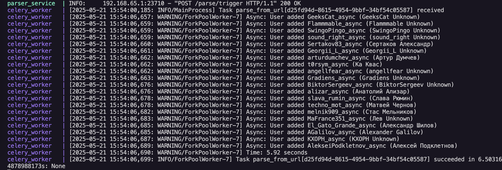
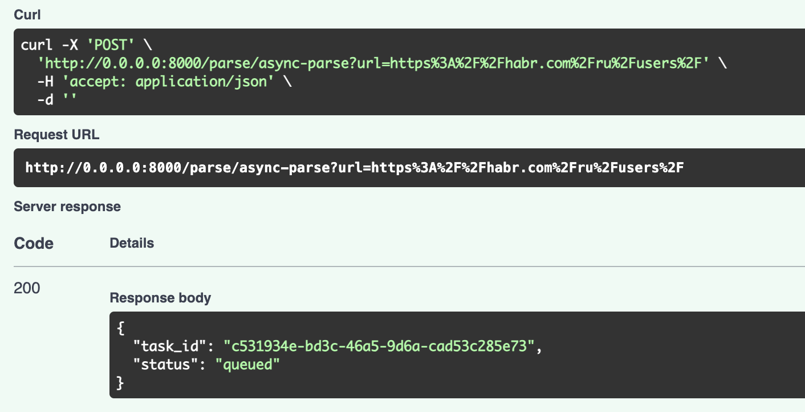
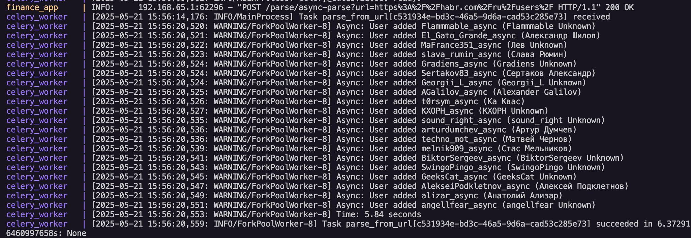

# Лабораторная работа: Интеграция парсера данных с FastAPI и использование очередей Celery в Docker

## Цель
Научиться упаковывать FastAPI приложения в Docker, создавать связь между основным приложением и сервисом парсинга данных, а также реализовать асинхронное выполнение задач с использованием очередей Celery и Redis.

## Архитектура проекта
Проект состоит из следующих компонентов:

- Основное FastAPI приложение (finance_app)

- Сервис парсера (parser_service)

- База данных PostgreSQL

- Redis для хранения очередей задач

- Celery для обработки асинхронных задач


## Подзадача 1: Упаковка сервисов в Docker

### Parser Service - Dockerfile
```dockerfile
FROM python:3.13-slim

RUN apt-get update && apt-get install -y \
    gcc build-essential libpq-dev \
    && rm -rf /var/lib/apt/lists/*

WORKDIR /app

COPY . /app

RUN pip install --no-cache-dir -r /app/req.txt

EXPOSE 8001

CMD ["uvicorn", "api:app", "--host", "0.0.0.0", "--port", "8001"]
```

### Finance App - Dockerfile
```dockerfile
FROM python:3.11-slim

RUN apt-get update && apt-get install -y \
    gcc build-essential libpq-dev \
    && rm -rf /var/lib/apt/lists/*

WORKDIR /app

COPY . /app

RUN pip install --no-cache-dir -r /app/req.txt

EXPOSE 8000

CMD ["uvicorn", "main:app", "--host", "0.0.0.0", "--port", "8000"]
```

### Docker Compose для оркестрации сервисов
```yaml
services:
  db:
    image: postgres:15
    container_name: finance_db
    environment:
      POSTGRES_DB: finance
      POSTGRES_USER: postgres
      POSTGRES_PASSWORD: postgres
    ports:
      - "5432:5432"
    volumes:
      - db_data:/var/lib/postgresql/data
    healthcheck:
      test: ["CMD", "pg_isready", "-U", "postgres"]
      interval: 2s
      timeout: 3s
      retries: 5

  finance_app:
    build:
      context: ./Lr1/lab1/app
    container_name: finance_app
    depends_on:
      db:
        condition: service_healthy
    ports:
      - "8000:8000"
    environment:
      DB_ADMIN: postgresql+psycopg2://postgres:postgres@db:5432/finance
    restart: always

  parser_service:
    build:
      context: ./Lr2/task2
    container_name: parser_service
    depends_on:
      db:
        condition: service_healthy
    ports:
      - "8001:8001"
    environment:
      DB_ADMIN: postgresql+asyncpg://postgres:postgres@db:5432/finance
    restart: always

  redis:
    image: redis:7
    container_name: redis
    ports:
      - "6379:6379"

  celery_worker:
    build:
      context: ./Lr2/task2
    container_name: celery_worker
    command: celery -A celery_worker worker --loglevel=info
    depends_on:
      db:
        condition: service_healthy
      parser_service:
        condition: service_started
      redis:
        condition: service_started
    environment:
      DB_ADMIN: postgresql+asyncpg://postgres:postgres@db:5432/finance
      CELERY_BROKER_URL: redis://redis:6379/0
      CELERY_RESULT_BACKEND: redis://redis:6379/0
    restart: on-failure

volumes:
  db_data:
```

## Подзадача 2: Реализация API парсера

### Parser Service - API (api.py)
```python
from fastapi import FastAPI, HTTPException
from pydantic import BaseModel
import async_
from celery_worker import parse_from_url, celery_app
from run import extract_user_links 

app = FastAPI(title="Parser Service")

class ParseRequest(BaseModel):
    url: str

@app.post("/parse")
async def parse_users(request: ParseRequest):
    try:
        user_links = await extract_user_links(request.url)
        if not user_links:
            return {"message": "No user links found"}

        await async_.main(user_links)
        return {"message": f"Parsed {len(user_links)} users"}
    except Exception as e:
        raise HTTPException(status_code=500, detail=str(e))

@app.post("/parse/trigger")
async def trigger_parse(request: ParseRequest):
    task = parse_from_url.delay(request.url)
    return {"message": "Parsing started", "task_id": task.id}

@app.get("/parse/status/{task_id}")
async def get_task_status(task_id: str):
    result = celery_app.AsyncResult(task_id)
    return {
        "task_id": task_id,
        "status": result.status,
        "result": result.result if result.ready() else None,
        "successful": result.successful() if result.ready() else None
    }
```



## Подзадача 3: Настройка Celery для асинхронного выполнения задач

### Celery Worker (celery_worker.py)
```python
from celery import Celery
import asyncio
from run import extract_user_links 
import async_

celery_app = Celery(
    "parser",
    broker="redis://redis:6379/0",
    backend="redis://redis:6379/0",
)

@celery_app.task(name="parse_from_url")
def parse_from_url(url: str):
    asyncio.run(run_async(url))

async def run_async(url: str):
    user_urls = await extract_user_links(url)
    await async_.main(user_urls)
```





## Подзадача 4: Интеграция парсера с основным приложением

### Router для вызова парсера из основного приложения
```python
from fastapi import APIRouter, HTTPException
from celery import Celery
import httpx
from pydantic import BaseModel
import os
from dotenv import load_dotenv

router = APIRouter(prefix="/parse", tags=["Parser"])

PARSER_URL = "http://parser_service:8001/parse"
print("DEBUG PARSER_URL =", PARSER_URL)

celery_app = Celery(
    "parser_celery",
    broker="redis://redis:6379/0",
    backend="redis://redis:6379/0",
)

class ParseRequest(BaseModel):
    url: str

@router.post("/")
async def call_parser(request: ParseRequest):
    url = request.url
    async with httpx.AsyncClient(timeout=10) as client:
        try:
            response = await client.post(PARSER_URL, json={"url": url}) 
            response.raise_for_status()
            return response.json()
        except httpx.RequestError as e:
            print("httpx.RequestError:", repr(e))
            raise HTTPException(status_code=502, detail=f"Parser service not available: {repr(e)}")
        except httpx.HTTPStatusError as e:
            raise HTTPException(status_code=response.status_code, detail=response.text)

@router.post("/async-parse")
def enqueue_parse_task(url: str):
    task = celery_app.send_task("parse_from_url", args=[url])  
    return {"task_id": task.id, "status": "queued"}
```




## Принцип работы системы

**Синхронный вызов парсера**:

   - Запрос приходит на эндпоинт `/parse` основного приложения

   - Основное приложение перенаправляет запрос в сервис парсера

   - Парсер выполняет обработку и возвращает результат

**Асинхронный вызов парсера через очередь**:

   - Запрос приходит на эндпоинт `/parse/async-parse` основного приложения

   - Основное приложение создает задачу в очереди Celery

   - Задача обрабатывается Celery worker'ом асинхронно

   - Клиент может проверить статус выполнения задачи по её ID

**Проверка статуса задачи**:

   - Запрос на эндпоинт `/parse/status/{task_id}` возвращает текущий статус задачи
   
   - При готовности результата, возвращается также и сам результат

## Схема взаимодействия компонентов

1. **finance_app** - основное приложение с бизнес-логикой
2. **parser_service** - микросервис для парсинга данных 
3. **redis** - хранилище для очередей задач
4. **celery_worker** - обработчик асинхронных задач
5. **db** - база данных PostgreSQL для хранения обработанных данных

Все компоненты взаимодействуют между собой в рамках Docker-сети, что обеспечивает изоляцию и независимость сервисов.